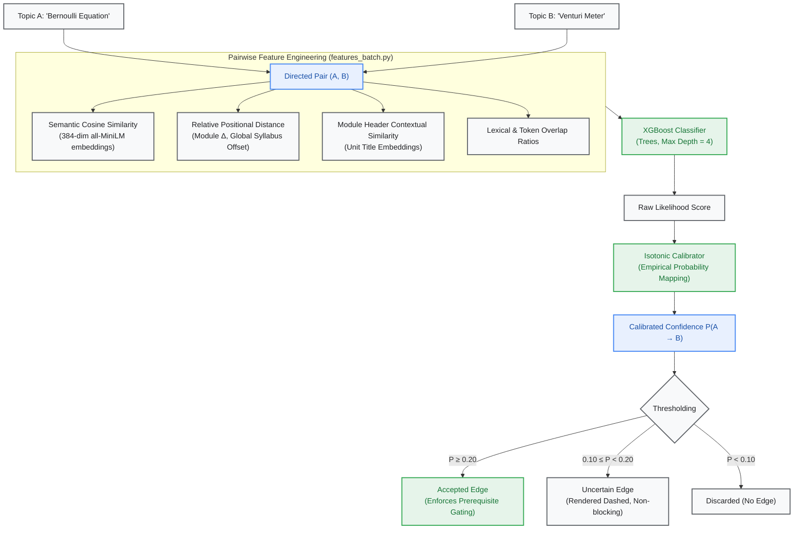
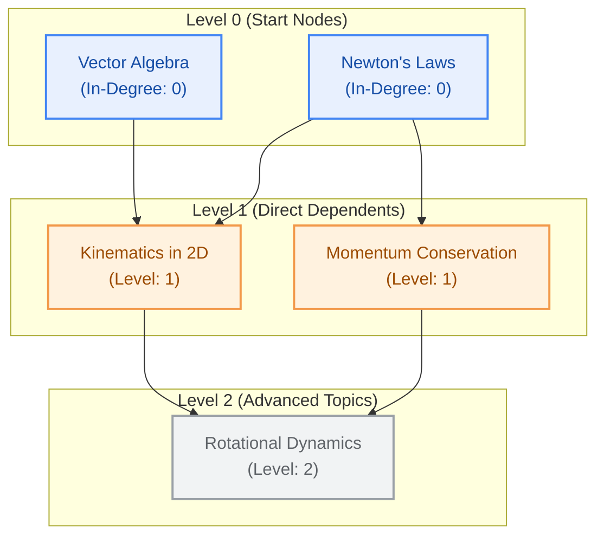
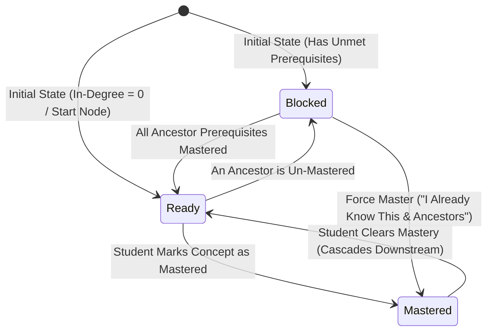

# 🧠 KDG (Knowledge Dependency Graph)

<div align="center">


<p align="center">
  <b>Autonomous Knowledge Dependency Graph & Adaptive Learning Engine for Mumbai University NEP Syllabi</b><br>
  Transforms unstructured, linear engineering syllabi into directed, calibrated prerequisite graphs, bottleneck analytics, and dynamic mastery paths.
</p>

[Key Capabilities](#-key-capabilities) • [System Architecture](#-how-it-works-system-architecture) • [Graph & Learning Engine](#-graph-algorithms--learning-engine) • [API Reference](#-api-specification) • [Interactive Demo](#-interactive-web-demo) • [Getting Started](#-installation--quickstart)

</div>

---

## 📌 Executive Overview

Traditional academic university syllabi—such as the **Mumbai University National Education Policy (NEP)** curriculum—are published as static, linear PDF documents. While they describe *what* topics are taught within course modules, they obscure:
1. **Implicit Prerequisite Structures:** Which fundamental concepts must be mastered before tackling advanced topics across modules?
2. **Curricular Bottlenecks:** Which high-leverage gateway concepts unlock the largest downstream portion of the course?
3. **Optimal Sequencing:** In what non-linear order should a self-paced student or remedial program traverse the concepts?
4. **Assumed Background Knowledge:** Which prerequisite domains (e.g., linear algebra, multivariable calculus) are assumed by the syllabus but never explicitly taught?

**KDG (Knowledge Dependency Graph)** resolves this challenge. By combining **deterministic layout-aware PDF table extraction**, **sentence-transformer semantic embeddings**, **calibrated gradient-boosted decision trees (XGBoost)**, and **pure graph-theoretic algorithms (Kahn's Topological Sort, Transitive Reduction)**, KDG produces a robust, verified, and interactive prerequisite roadmap with per-edge calibrated confidence.

> [!NOTE]
> **Offline Inference Doctrine:** The core parser, feature extractor, and prerequisite prediction model operate **100% offline** with zero external network dependencies or runtime API costs. A resilient fallback service is available for malformed non-standard PDFs, adhering strictly to a generator-neutral privacy protocol.

---

## ⚡ Key Capabilities

```
                  ┌──────────────────────────────────────────────┐
                  │          Raw NEP Syllabus PDF File           │
                  └──────────────────────┬───────────────────────┘
                                         ▼
 ┌───────────────────────┐    ┌───────────────────────┐    ┌───────────────────────┐
 │   Deterministic PDF   │───▶│   Machine Learning    │───▶│ Pure Graph Analytics  │
 │    Table Extractor    │    │  Prerequisite Engine  │    │   & Mastery State     │
 └───────────────────────┘    └───────────────────────┘    └───────────────────────┘
  • Multi-page stitching       • 384-dim MiniLM vectors     • Cycle-free DAG filtering
  • Clean topic splitting      • Structural position bias   • Transitive reduction
  • Verification & 3-Tier gate • Isotonic calibration       • Kahn's study sequencing
  • Stop-marker sanitation     • Confidence banding         • Bottleneck detection
```

* **Multi-Page Table Stitching & Topic Parsing:** Utilizes structural bounding-box analysis and table detection (`PyMuPDF`) to reconstruct fractured module tables across page breaks, stripping contact hours, Course Outcomes (COs), and textbook references.
* **Rigorous Verification & Quality Gating:** Implements a three-tier quality evaluation (`accepted`, `review`, `rejected`). Every topic is verified for textual traceability against source PDF pages.
* **Calibrated Pairwise Prerequisite Classification:** Models directed conceptual relationships between topic pairs $(u \to v)$ using semantic similarity, module hierarchy distances, lexical overlaps, and isotonic probability calibration.
* **Graph-Theoretic Study Sequencing:** Employs **Kahn's Algorithm** with syllabus-order tie-breaking to compute topological learning stages (`kahn_order`) and hierarchical depth levels (`depth`).
* **Critical Bottleneck Identification:** Identifies single-point-of-failure concepts that govern the highest downstream connectivity (direct and transitive unlocks).
* **Assumed Background Knowledge Extractor:** Automatically extracts foundational skills required prior to commencing the course.
* **Dynamic Mastery State Machine:** Tracks student mastery states (`mastered`, `ready`, `blocked`), computing missing prerequisite ancestry paths with cascading rollbacks and override options.
* **Generator-Neutral Resilient API:** Ensures all client-facing contracts remain strictly agnostic of underlying computation backends, logging execution telemetry privately on the server.

---

## 🏗️ How It Works: System Architecture

The following diagram illustrates the complete end-to-end execution lifecycle of a syllabus analysis, designed to render clearly across desktop monitors and mobile devices.

```mermaid
flowchart TD
    classDef io fill:#E8F0FE,stroke:#4285F4,stroke-width:2px,color:#174EA6;
    classDef process fill:#F8F9FA,stroke:#5F6368,stroke-width:2px,color:#202124;
    classDef gate fill:#FEF7E0,stroke:#F9AB00,stroke-width:2px,color:#B06000;
    classDef engine fill:#E6F4EA,stroke:#34A853,stroke-width:2px,color:#137333;
    classDef store fill:#F3E8FD,stroke:#A142F4,stroke-width:2px,color:#8430CE;

    PDF["📄 User Uploads Syllabus PDF"]:::io --> Hash["Compute SHA-256 Digest & Cache Check"]:::process
    
    subgraph S1["1. Deterministic Layout Parsing"]
        Hash --> Tables["Extract Module Tables & Boundaries<br/>(PyMuPDF find_tables)"]:::process
        Tables --> Normalize["Clean & Split Topic Strings<br/>(Remove COs, Hours & Markers)"]:::process
        Normalize --> Tier["3-Tier Quality Gate<br/>(Traceability & Completeness Check)"]:::gate
    end

    Tier -->|"Tier: Accepted / Review"| ExtractDone["Extracted Valid Topics & Metadata"]:::process
    Tier -->|"Tier: Rejected / Malformed"| Fallback["Resilient Fallback Service<br/>(Schema-Constrained Normalization)"]:::process
    Fallback --> ExtractDone

    subgraph S2["2. Calibrated Prerequisite Prediction"]
        ExtractDone --> Embed["Semantic Dense Embeddings<br/>(all-MiniLM-L6-v2)"]:::process
        Embed --> FeatureMatrix["Pairwise Feature Synthesis<br/>(Positions, Cosine Sim, Cross-Module)"]:::process
        FeatureMatrix --> XGB["XGBoost Classification & Isotonic Calibration"]:::engine
        XGB --> Bands["Confidence Categorization<br/>• Accepted: ≥ 0.20 (Blocks)<br/>• Uncertain: 0.10–0.20 (Dashed)"]:::gate
    end

    subgraph S3["3. Topological Graph Operations"]
        Bands --> DAG["Cycle Elimination & Degree Filter<br/>(In-Degree ≤ 3, Out-Degree ≤ 6)"]:::engine
        DAG --> Transitive["Transitive Reduction<br/>(Tag Redundant Shortcuts)"]:::engine
        Transitive --> Kahn["Kahn's Topological Sort<br/>(Syllabus-Preserving Tie Breaking)"]:::engine
        Kahn --> Analytics["Compute Bottlenecks & Assumed Background"]:::engine
    end

    Analytics --> Payload["Assemble Unified Analysis Payload"]:::io
    Payload --> DiskStore[("Runtime Storage<br/>data/runtime/analyses/")]:::store
    Payload --> Response["Interactive Graph UI & Mobile Client"]:::io
```



---

## 🔬 Core Components & Engineering Depth

### 1. Document Extraction & Quality Gating (`app/parser/`)

University PDFs feature diverse multi-column, nested, and broken table formats. Rather than applying fragile text scraping, KDG uses structural coordinate analysis:

| Module | Purpose & Implementation |
|---|---|
| [`nep_tables.py`](file:///c:/Users/Siddhesh/Documents/KDG/app/parser/nep_tables.py) | Scans raw PDF pages using PyMuPDF `find_tables()`. Stitches course headers, scheme details, and multi-page module continuations into coherent table structures. |
| [`nep_topics.py`](file:///c:/Users/Siddhesh/Documents/KDG/app/parser/nep_topics.py) | Splits compound entries on punctuation, delimiters, and bullet items. Filters out self-learning labels, reference books, hours, and Bloom's taxonomy tags. |
| [`nep_gate.py`](file:///c:/Users/Siddhesh/Documents/KDG/app/parser/nep_gate.py) | Evaluates course integrity against minimum module criteria, word counts, and structural completeness. |
| [`nep_verify.py`](file:///c:/Users/Siddhesh/Documents/KDG/app/parser/nep_verify.py) | Verifies textual traceability by checking if extracted topic n-grams exist verbatim within the source document text layer. |
| [`nep_tier.py`](file:///c:/Users/Siddhesh/Documents/KDG/app/parser/nep_tier.py) | Classifies courses into `accepted` (direct processing), `review` (safe with minor deviations), or `rejected` (requires fallback intervention). |

---

### 2. Machine Learning Prerequisite Engine (`app/ml/`)

Prerequisite classification solves the directed pair problem: *does understanding concept $A$ precede concept $B$ ($A \to B$)?*



#### Prerequisite Pair Feature Vector
For every topic pair $(u, v)$, the engine extracts:
* **Semantic Embeddings:** Cosine similarity and element-wise differences between sentence embeddings computed via `sentence-transformers/all-MiniLM-L6-v2`.
* **Hierarchical Positional Biases:** Relative module index distance $(\text{module}_v - \text{module}_u)$, intra-module order distance, and normalized syllabus offset.
* **Contextual Anchors:** Embedding similarity between Topic $u$ and the module heading of Topic $v$.
* **Syntactic Overlaps:** Shared terminology and sub-string token intersections.

#### Isotonic Probability Calibration
Raw tree ensemble outputs often suffer from uncalibrated distortion. An **Isotonic Regression Calibrator** maps raw predictions into strictly monotonic, empirically faithful probabilities:
* **$P \ge 0.70$:** High precision ($\sim 80\%$ empirical accuracy on held-out test departments).
* **$0.50 \le P < 0.70$:** Strong confidence ($\sim 59\%$ empirical accuracy).
* **$0.20 \le P < 0.50$:** Accepted prerequisite dependency.
* **$0.10 \le P < 0.20$:** Uncertain advisory relationship (visualized with dashed strokes; never impedes learning flow).

---

### 3. Graph Algorithms & Learning Engine (`app/services/graph_ops.py`)



1. **Cycle Prevention & Degree Caps:**
   To guarantee an acyclic learning path and avoid cognitive saturation, edges are added iteratively to a directed graph:
   $$\text{In-Degree}(v) \le 3 \quad \text{and} \quad \text{Out-Degree}(u) \le 6$$
   Any edge that introduces a directed cycle is eliminated immediately.

2. **Transitive Reduction:**
   When dependencies exist such that $A \to B \to C$ and a redundant shortcut $A \to C$ is predicted, the graph tags the direct edge as:
   $$\text{redundant} = \text{true}$$
   This simplifies visualization without corrupting dependency requirements.

3. **Kahn's Topological Sort with Syllabus Tie-Breaking:**
   Topics ready concurrently are sorted using a min-heap on their original syllabus position, preserving the textbook reading order while honoring all prerequisites.

4. **Curricular Bottleneck Analysis:**
   Nodes are ranked by the volume of downstream content they unlock:
   $$\text{Bottleneck Score}(u) = \lvert \text{Descendants}(u) \rvert$$
   Nodes with the highest transitive reach are highlighted as mission-critical gateway concepts.

---

### 4. Interactive Mastery State Machine (`app/services/progress.py`)

The mastery engine maintains a clean, deterministic state machine per student and analysis:



#### State Definitions
* 🟦 **READY (`ready`):** All prerequisite parents are mastered (or topic is an intrinsic start node). The student can study this topic immediately.
* 🟨 **BLOCKED (`blocked`):** One or more direct prerequisites remain unmastered. Attempting to mark this topic returns an `HTTP 409 Conflict` containing the exact prerequisite path.
* 🟩 **MASTERED (`mastered`):** The student has verified competence in this concept.
* ⚡ **FORCE OVERRIDE (`force=true`):** Allows accelerated learners to mark a blocked concept, automatically resolving and marking all transitive ancestors.
* 🔄 **CASCADING UN-MASTERY:** If an earlier foundational topic is unmarked, all downstream concepts that relied on it are automatically rolled back.

---

## 📡 API Specification

The FastAPI server provides high-throughput, clean endpoints mounted under `/api/v1`.

### Endpoint Directory

| Method | Endpoint | Description | Status Codes |
|---|---|---|---|
| `POST` | `/api/v1/analyze` | Uploads syllabus PDF; returns courses or full dependency graph | `200`, `400`, `413`, `422` |
| `GET` | `/api/v1/analysis/{analysis_id}` | Retrieves a previously computed analysis payload | `200`, `400`, `404` |
| `POST` | `/api/v1/progress/status` | Computes live node states given a set of mastered IDs | `200`, `400`, `404` |
| `POST` | `/api/v1/analytics/missing-prerequisites` | Returns ancestor prerequisite concepts missing for a target topic | `200`, `400`, `404` |
| `POST` | `/api/v1/progress/mastery` | Saves mastery update per user; enforces prerequisite constraints | `200`, `404`, `409` |
| `GET` | `/api/v1/progress/{user_id}/{analysis_id}` | Restores saved progress and active node states for a returning user | `200`, `400`, `404` |
| `GET` | `/healthz` | Liveness and model loading status | `200` |

---

### Detailed Endpoint Contracts

#### 1. Analyze Syllabus PDF
```http
POST /api/v1/analyze
Content-Type: multipart/form-data
```
* **Parameters:**
  * `file`: Binary PDF stream (max 30 MB).
  * `subject` *(optional)*: Course code or title filter if the PDF contains multiple subjects.

<details>
<summary><b>Click to expand Example Response JSON</b></summary>

```json
{
  "needs_subject": false,
  "analysis_id": "3fa2c1d09b7e-2073112",
  "course_code": "2073112",
  "course_title": "Fluid Flow Operations",
  "thresholds": {
    "accepted": 0.20,
    "uncertain": 0.10
  },
  "nodes": [
    {
      "id": "2073112:1:bernoulli-s-equation",
      "name": "Bernoulli's equation",
      "unit": 1,
      "unit_title": "Fluid Dynamics",
      "depth": 2,
      "kahn_index": 14,
      "is_start": false
    }
  ],
  "edges": [
    {
      "source": "2073112:1:continuity-equation",
      "target": "2073112:1:bernoulli-s-equation",
      "confidence": 0.584,
      "band": "accepted",
      "redundant": false
    }
  ],
  "kahn_order": [
    "2073112:1:fluid-properties",
    "2073112:1:continuity-equation",
    "2073112:1:bernoulli-s-equation"
  ],
  "start_nodes": [
    "2073112:1:fluid-properties"
  ],
  "study_flow": [
    {
      "step": 1,
      "id": "2073112:1:fluid-properties",
      "name": "Fluid Properties",
      "unit": 1,
      "level": 0,
      "prerequisites": [],
      "prerequisite_ids": []
    }
  ],
  "bottlenecks": [
    {
      "id": "2073112:1:fluid-properties",
      "name": "Fluid Properties",
      "unlocks": 24,
      "direct": 5
    }
  ],
  "missing_prerequisites": [
    {
      "name": "Engineering Mathematics - Calculus",
      "reason": "Listed as an assumed foundation in syllabus scheme.",
      "needed_for": []
    }
  ]
}
```
</details>

---

#### 2. Progress Mastery Update
```http
POST /api/v1/progress/mastery
Content-Type: application/json
```
```json
{
  "user_id": "usr_94b29c",
  "analysis_id": "3fa2c1d09b7e-2073112",
  "topic_id": "2073112:1:bernoulli-s-equation",
  "mastered": true,
  "force": false
}
```

* **Responses:**
  * `200 OK`: Returns updated graph node states, ready list, and progress percentage.
  * `409 Conflict`: If the topic is currently `blocked`. Returns:
    ```json
    {
      "detail": {
        "error": "blocked",
        "waiting_on": ["2073112:1:continuity-equation"],
        "missing": [
          {"id": "2073112:1:continuity-equation", "name": "Continuity Equation"}
        ]
      }
    }
    ```

---

## 💻 Interactive Web Demo

The repository contains a zero-dependency, standalone visualizer located at [`demo/kdg_demo.html`](file:///c:/Users/Siddhesh/Documents/KDG/demo/kdg_demo.html).

<div align="center">
  
</div>

```
┌─────────────────────────────────────────────────────────────────────────────┐
│ KDG Prerequisite Graph Demo           Course: [ Fluid Flow Operations ▼ ]   │
├──────────────────────────────────────────────────────┬──────────────────────┤
│                                                      │ [ Legend ]           │
│    [Fluid Properties] ───▶ [Continuity Equation]     │ 🟩 Mastered          │
│            │                       │                 │ 🟦 Ready (Start)     │
│            ▼                       ▼                 │ ⬜ Blocked           │
│     [Viscosity Laws]      [Bernoulli Equation]       ├──────────────────────┤
│                                    │                 │ [ Active Node ]      │
│                                    ▼                 │ Bernoulli Equation   │
│                           [Venturi Flow Meters]      │ Status: BLOCKED      │
│                                                      │ Needs: Continuity Eq │
│                                                      │ [ Force Unlock ]     │
└──────────────────────────────────────────────────────┴──────────────────────┘
```

### Key Interactive Features:
1. **Interactive Node States:** Click any blue (ready) node to toggle mastery. The canvas dynamically evaluates graph ancestry, unlocking downstream nodes in real-time.
2. **Confidence Threshold Slider:** Adjust the acceptance threshold dynamically between $0.05$ and $0.90$ to inspect model edge pruning.
3. **Uncertain Edges Filter:** Toggle visualization of low-confidence advisory relationships ($0.10 \le P < 0.20$).
4. **Transitive Reduction Filter:** Toggle redundant transitive shortcuts to inspect the minimal topological backbone.
5. **Kahn Progression Steps:** Step through the topological sort order to preview recommended linear study paths.

To launch the demo locally:
```bash
# Simply open in any modern browser:
open demo/kdg_demo.html
# On Windows PowerShell:
Start-Process demo/kdg_demo.html
```

---

## 📊 Model Architecture & Empirical Performance

The production model bundle is deployed under `app/ml/model_artifact_nep6*`.

### Pipeline Specifications
* **Base Sentence Encoder:** `sentence-transformers/all-MiniLM-L6-v2` (384-dimensional dense semantic vectors).
* **Classifier:** Gradient-Boosted Decision Trees (`XGBoost`), max depth 4.
* **Calibrator:** Monotonic Isotonic Regression mapping raw margins to empirical probabilities.
* **Default Thresholds:**
  * **Accepted (Blocking):** $P \ge 0.20$
  * **Uncertain (Advisory):** $0.10 \le P < 0.20$
  * **Direction Margin:** $0.10$

### Performance on Unseen Course Syllabi
The model was tested against held-out syllabus documents across disparate engineering branches never encountered during training:

| Test Department | Evaluated Courses | Precision | Recall | F1 Score | PR-AUC | Calibration Error |
|---|:---:|:---:|:---:|:---:|:---:|:---:|
| **Chemical Engineering** (Sem 3/4) | 6 | 0.396 | 0.527 | **0.452** | 0.380 | 0.002 |
| **Electronics & Telecomm.** (Sem 5/6) | 3 | 0.325 | 0.604 | **0.423** | 0.345 | 0.001 |
| **Mechanical Engineering** (Sem 3/4) | 4 | 0.323 | 0.411 | **0.362** | 0.298 | 0.003 |
| **Mechanical Engineering** (Sem 5/6) | 5 | 0.311 | 0.498 | **0.383** | 0.318 | 0.001 |
| **Aggregated Unseen Benchmark** | **18** | **0.336** | **0.495** | **0.400** | **0.335** | **0.001** |

> [!TIP]
> **Reading the Probabilities:**
> Edge directions are accurate for over $99\%$ of predicted linkages. High-confidence edges ($P \ge 0.70$) demonstrate $80\%$ empirical alignment with domain consensus, isolating primary theoretical dependencies. Edges in the $0.20 \le P < 0.50$ range provide structured guidance and can be inspected or overridden seamlessly using the mastery controls.

---

## 🚀 Installation & Quickstart

### Prerequisites
* Python 3.10, 3.11, or 3.12
* Minimum 4 GB RAM (sufficient for CPU sentence-transformer embeddings)

### Step 1: Clone & Install Dependencies
```bash
git clone https://github.com/your-username/KDG.git
cd KDG

# Create and activate virtual environment
python -m venv venv
# On Windows:
.\venv\Scripts\activate
# On Linux/macOS:
source venv/bin/activate

# Install dependencies
pip install -r requirements.txt
```

### Step 2: One-Time Hugging Face Model Cache
To ensure complete offline execution at runtime, pre-cache the sentence transformer weights once:
```bash
python -c "from sentence_transformers import SentenceTransformer; SentenceTransformer('sentence-transformers/all-MiniLM-L6-v2')"
```

### Step 3: Run the API Server
```bash
uvicorn app.main:app --port 8000 --reload
```
Once initialized, access:
* **Interactive Swagger UI:** [http://127.0.0.1:8000/docs](http://127.0.0.1:8000/docs)
* **ReDoc Documentation:** [http://127.0.0.1:8000/redoc](http://127.0.0.1:8000/redoc)
* **Liveness Health Check:** [http://127.0.0.1:8000/healthz](http://127.0.0.1:8000/healthz)

---

## 🧪 Verification & Testing

Execute the automated test suite offline:
```bash
# Run API contracts, graph rules, and fallback tests
python -m pytest tests -q
```

All 9 primary regression suites validate:
* Kahn topological sequencing and level assignment.
* Mastery state transitions and 409 conflict handling.
* Cascading un-mastery across descendants.
* Transitive reduction integrity.
* Strict generator-neutral response validation (preventing backend leakage).

---

## ⚙️ Environment Configuration

Configure runtime options via environment variables or a local `.env` file:

| Variable | Default Value | Description |
|---|---|---|
| `KDG_MODEL` | `nep6` | Identifier of the ML model bundle loaded in `app/ml/`. |
| `KDG_CORS` | `http://localhost:5173,...` | Allowed CORS origins for frontend web integration. |
| `KDG_RUNTIME_DIR` | `data/runtime/` | File-system path where analysis results and progress state JSONs are persisted. |
| `KDG_LOG_LEVEL` | `INFO` | Python logging level (`DEBUG`, `INFO`, `WARNING`, `ERROR`). |
| `GEMINI_API_KEY` | *(Optional)* | Key for secondary fallback parsing when handling unparseable or corrupted PDF layouts. |
| `HF_HUB_OFFLINE` | `1` | Enforces the offline inference doctrine for Hugging Face models. |

---

## 📁 Repository Structure

```
KDG/
├── app/
│   ├── main.py                  # FastAPI bootstrap, lifespan model warm-up & CORS
│   ├── api/
│   │   └── routes.py            # API routes (/analyze, /progress, /analytics)
│   ├── parser/
│   │   ├── nep_tables.py        # PyMuPDF table detection & multi-page stitcher
│   │   ├── nep_topics.py        # Topic normalization & delimiter sanitation
│   │   ├── nep_gate.py          # Quality criteria gate & structural validator
│   │   ├── nep_verify.py        # Source document traceability verifier
│   │   └── nep_tier.py          # 3-tier classification (accepted/review/rejected)
│   ├── ml/
│   │   ├── infer.py             # Model bundle loader & graph edge inference
│   │   ├── features_batch.py    # Pair feature computation (embeddings, positions)
│   │   ├── model_artifact_nep6.joblib  # Trained production XGBoost model
│   │   └── calibrator_nep6.joblib      # Isotonic probability calibration
│   └── services/
│       ├── pipeline.py          # Master analysis pipeline & fallback coordination
│       ├── graph_ops.py         # Pure graph rules: Kahn, DAG, bottlenecks, ancestry
│       ├── progress.py          # Mastery state machine & persistence rules
│       └── fallback.py          # Privacy-compliant secondary parsing fallback
├── data/
│   ├── raw/                     # Original university syllabus PDFs (frozen)
│   ├── processed/               # Parsed training tables and intermediate corpora
│   └── runtime/                 # Ephemeral analysis payloads & user progress (git-ignored)
├── demo/
│   ├── kdg_demo.html            # Compiled interactive standalone HTML/SVG demo
│   └── kdg_demo.template.html   # Source visualization template
├── scripts/
│   ├── train_nep.py             # Model training & isotonic calibration pipeline
│   ├── eval_models.py           # Evaluation benchmarks on held-out courses
│   └── build_demo.py            # Generates standalone interactive demo
├── tests/
│   ├── test_api.py              # End-to-end API, graph rule & mastery tests
│   └── test_features_batch.py   # Feature engineering consistency tests
├── requirements.txt             # Locked Python production dependencies
└── README.md                    # Project documentation
```

---

<div align="center">
  <sub>Developed for Mumbai University NEP Syllabus Knowledge Dependency Generation & Learning Analytics.</sub>
</div>

